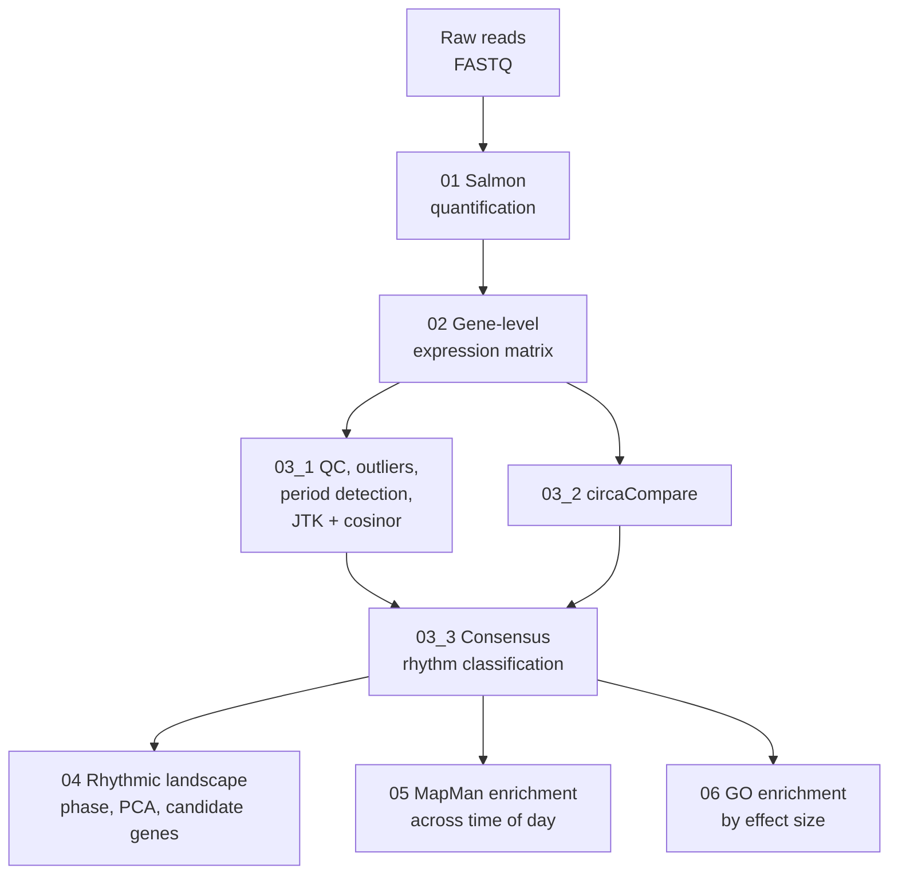

# diurnal-rnaseq-rhythms
THis an R workflow for analysing rhythmic gene expression in time-course RNA-seq data from two conditions, for example a control and a treatment sampled across one or more diurnal cycles.

It takes raw reads and produces:

* gene-level expression matrices for both conditions,
* quality control, outlier detection and period detection,
* rhythmicity calls from three independent methods (JTK_CYCLE, cosinor regression, circaCompare),
* a consensus classification of every gene as **rhythmic in both conditions**, **rhythmic in one condition only** (lost or gained) or **not rhythmic**,
* the timing (acrophase), baseline (mesor) and amplitude of each rhythm, and how they change between conditions,
* functional enrichment (MapMan and GO) of rhythmic genes across the time of day and of genes whose rhythm changes.




---

# Getting started

R packages:

```r
install.packages(c("tidyverse", "pheatmap", "ggrepel", "patchwork", "scales",
                   "ggVennDiagram", "eulerr", "circacompare", "future", "furrr", "fs"))

if (!require("BiocManager", quietly = TRUE)) install.packages("BiocManager")
BiocManager::install(c("tximport", "rtracklayer", "DiscoRhythm", "SummarizedExperiment",
                       "clusterProfiler", "enrichplot", "ggtree", "GO.db",
                       "AnnotationDbi", "org.At.tair.db"))
```

`org.At.tair.db` is the *Arabidopsis* annotation package. For another organism, replace it with the matching `org.*.db` package.


### Running the workflow

Open the repository as an RStudio project and run the scripts in numerical order from the repository root.

Steps `03_1` and `03_2` can run in either order, and steps `04`, `05` and `06` only need `03_3`.

---

# Step 1: Quantify reads with Salmon

`scripts/01_salmon_quantification/`

### 01_1_build_salmon_index.sh

Builds a decoy-aware Salmon index:

1. extracts all transcript sequences from the genome using the GTF (`gffread`),
2. writes the names of all genome sequences to a decoy list,
3. joins transcripts and genome into one "gentrome" FASTA,
4. builds the Salmon index with the genome as decoy (`k = 31`).

Using the genome as decoy prevents reads from intergenic regions being falsely assigned to transcripts. Run it once in the folder containing the genome FASTA and GTF.

### 01_2_salmon_quantification.Rmd

Quantifies every FASTQ file in a folder against the index:

* asks you to select the working directory, the Salmon index and the folder with the raw reads,
* runs `salmon quant` for each sample with automatic library type detection and selective alignment (`--validateMappings`),
* writes one `<sample>_quant/` folder per sample containing `quant.sf`.

The script expects single-end reads. Set the path to the Salmon executable at the top. Quantifying many samples can be computationally heavy, so a workstation or server is recommended.


---

# Step 2: Build the expression matrix

`scripts/02_expression_matrix/02_expression_matrix.R`

* finds all `quant.sf` files and sorts samples numerically by their ID,
* builds a transcript-to-gene table from the GTF,
* summarises transcript estimates to **gene-level TPM** with `tximport`,
* splits the samples into the two conditions,
* renames the columns to the time-course format `hr<time>_<sampleID>_<replicate>` (e.g. `hr0_1_A`, `hr2_3_A`), which DiscoRhythm needs to read time and replicate from the sample name.


---

# Step 3: Detect rhythmic genes

`scripts/03_rhythm_detection/`

### 03_1_QC_period_detection.R

Quality control and rhythm detection with [DiscoRhythm](https://bioconductor.org/packages/DiscoRhythm/):

1. **Input checks:** removes genes with missing or constant values, and keeps genes expressed in both conditions for the combined analyses.
2. **Outlier detection:** flags samples with low inter-sample Spearman correlation or outlying positions in PCA, and plots correlation heatmaps and PCAs coloured by time point.
3. **Period detection:** fits cosine curves over a range of candidate periods and summarises the goodness of fit (R²) per period, to check which period dominates the data.
4. **Oscillation detection:** runs **JTK_CYCLE** and **cosinor regression** for every gene in each condition at 24, 12 and 8 h.

**Output:**
*  filtered data (`FilteredSE_*.rds`) and one table per condition × method × period (`<condition>_<method>_<period>_oscillation_df.csv`) with p/q-values, acrophase, amplitude and mesor,
*  heatmaps, PCA plots and period-selection plots.

### 03_2_circaCompare.R

Runs [circaCompare](https://github.com/RWParsons/circacompare) for every gene. circaCompare fits a joint 24 h cosinor model to both conditions and tests whether **mesor, amplitude and phase differ** between them.

* runs in parallel on several CPU cores (`n_workers`),
* saves a checkpoint after every batch of genes, so an interrupted run continues where it stopped,
* applies Benjamini–Hochberg correction to all difference tests.

**Output:** one row per gene with rhythmicity per condition, parameter estimates and adjusted p-values for each difference.

### 03_3_rhythm_classification.R

Combines the three methods into one high-confidence classification:

1. **Consensus set:** keeps genes called rhythmic by JTK_CYCLE, cosinor regression and circaCompare in at least one condition (intersection of all three, shown as a Venn diagram).
2. **Expression filter:** removes lowly expressed genes (mesor below a minimum).
3. **Relative amplitude filter:** relative amplitude = amplitude / mesor. The script tests a range of cutoffs and picks the one where the variance of between-condition changes is lowest, i.e. where noise-dominated genes are removed.
4. **Condition-specific calls:** a gene rhythmic in only one condition is only called *lost* or *gained* if its relative amplitude differs by at least a minimum Δ between conditions (with a sensitivity curve for this threshold). Otherwise it counts as rhythmic in both.
5. **Final classification:** *Rhythmic in both*, *Lost* (rhythmic only in the reference condition), *Gained* (rhythmic only in the treatment) or *Not rhythmic*.

**Output:**
**the central table used by all later steps**, with one row per gene: rhythm status, acrophase, amplitude, mesor and relative amplitude in both conditions, phase shift and amplitude fold change,
* JTK-based rhythmic gene lists per condition (`rhythmic_by_JTK_*.rds`),
 – Venn diagram, threshold selection plots and final classification bar chart.

The thresholds are set at the top of each step (`q_thresh`, `min_expression`, `relamp_cutoff`, `delta_min`).

---

# Step 4: Describe the rhythmic landscape
scripts/04_rhythmic_landscape

Summarises when and how genes oscillate in each condition. It only writes figures:

* correlation heatmaps (replicates averaged, in time order) and PCA of rhythmic genes only,
* number of genes in each rhythm class,
* **rose plots** of acrophase distributions (circular histograms of peak times) for both conditions,
* acrophase bin counts and Venn diagrams of rhythmic genes,
* **phase tracking:** where genes peaking at a given time in the reference condition peak in the treatment, and the distribution of phase shifts,
* fitted cosinor curves for the most strongly rhythmic genes and for genes in each change category,
* **candidate genes:** expression profiles, heatmaps, phase shifts and amplitude changes for user-defined gene lists (e.g. core clock genes),
* origin of lost and gained genes across the day, and mean phase shift per 1 h bin of the reference acrophase, with significance tests per bin.


---

# Step 5: Functional enrichment across the time of day (MapMan)

`scripts/05_MapMan_enrichment/`

Both scripts use the **MapMan4** classification and over-representation analysis with `clusterProfiler::enricher()`.

### 05_1_MapMan_phase_enrichment.R

* enrichment of all rhythmic genes per condition against all expressed genes,
* **circular clock plots:** enrichment of MapMan terms in 2 h acrophase bins, shown as rings around the 24 h clock, for all rhythmic genes and for genes rhythmic in both conditions,
* **odds-ratio comparison:** for genes rhythmic in both conditions, compares the enrichment of each term in each time bin between conditions, to find functional groups whose timing shifts,
* **term-level phase shifts:** phase shift of the genes in a term plotted against their acrophase in the reference condition, with trend lines for all terms.

**Output:** `results/` and `figures/05_MapMan_enrichment/` (`Circular_plots/`, `OddsRatio_RhythmicBoth/`, `Phase_Shift_Analysis/`).

### 05_2_MapMan_sliding_window.R

Replaces fixed time bins with a **sliding window** (e.g. 4 h wide, moved in 1 h steps):

* enrichment of MapMan terms at each window position, shown as tile maps across the day for both conditions,
* density of acrophases per MapMan term, to show when each functional group peaks,
* sliding-window version of the circular clock plots.

**Output:** `results/` and `figures/05_MapMan_enrichment/` (`Sliding_Window/`, `Density_Plots/`).

Window width, step size and minimum gene numbers are set at the top of the script.

---

# Step 6: GO enrichment of genes with changed rhythms

`scripts/06_GO_effect_size_thresholds/06_GO_effect_size_thresholds.R`

For genes rhythmic in both conditions, the script calculates three **effect sizes** between conditions:

| Measure | Meaning |
|---|---|
| log₂ mesor ratio | change in baseline expression |
| Δ relative amplitude | change in oscillation strength |
| phase shift (wrapped to ±12 h) | earlier or later peak |

It then:

* plots the distribution of each effect size,
* defines gene sets by **effect-size thresholds** in each direction (e.g. mesor down by more than 0.25 log₂), over a grid of thresholds,
* runs **GO enrichment** (Biological Process) for each set against all genes rhythmic in both conditions,
* checks how stable enriched terms are across thresholds, and shows them in bubble plots,
* clusters the enriched terms of selected gene sets into **tree plots** by semantic similarity, and compares which terms are shared between sets,
* plots mesor changes by time of day,
* writes input files for the MapMan desktop tool (time-of-day bins, mesor, amplitude and phase changes),
* extracts significant terms matching a keyword list (e.g. defence-related terms) with their genes.

Effect-size thresholds avoid relying on per-gene significance tests, which are often underpowered with few replicates.

**Output:** `results/` and `figures/06_GO_effect_size_thresholds/`.

Thresholds, GO ontology and the number of terms shown are set in Part 1 of the script.

---

# Adapting the workflow to your experiment

The scripts were written for one experiment, and some settings are fixed in the code:

| What | Where | Example setting |
|---|---|---|
| assignment of samples to conditions | `02_expression_matrix.R`, step 5 | samples 1–50 = treatment, 51–100 = control |
| time points and replicates in column names | `02_expression_matrix.R`, step 6 | 25 time points every 2 h, replicates A and B |
| condition names in variables and labels | all scripts | `mock` / `dex` |
| tested periods | `03_1`, sections "Period detection" and "Oscillation detection" | 24, 12 and 8 h |
| number of CPU cores | `03_2`, `n_workers` | 6 |
| rhythmicity and filtering thresholds | top of `03_3` | q ≤ 0.05, mesor ≥ 5, relative amplitude ≥ 12 %, Δ ≥ 3 % |
| candidate gene lists | `04`, "Candidate gene analysis" | *Arabidopsis* clock genes |
| annotation | `05`, `06` | MapMan4 for Araport11, `org.At.tair.db` |

---

# Example

This workflow was developed for the Master's thesis *"TOR kinase shapes the timing of rhythmic outputs in Arabidopsis roots"* (Valentin Rebernig, Centre for Organismal Studies, Heidelberg University, 2026):

* *Arabidopsis thaliana* roots, control and treatment,
* sampling every 2 h for 48 h (25 time points) under a 12 h light / 12 h dark cycle,
* 2 replicates per time point, 100 single-end RNA-seq libraries.

---

## Citation

If you use this workflow, please cite the tools it builds on:

* **Salmon:** Patro, R. et al. (2017) Salmon provides fast and bias-aware quantification of transcript expression. *Nature Methods* 14, 417–419. https://doi.org/10.1038/nmeth.4197
* **tximport:** Soneson, C., Love, M.I. & Robinson, M.D. (2015) Differential analyses for RNA-seq: transcript-level estimates improve gene-level inferences. *F1000Research* 4, 1521. https://doi.org/10.12688/f1000research.7563.2
* **DiscoRhythm:** Carlucci, M. et al. (2020) DiscoRhythm: an easy-to-use web application and R package for discovering rhythmicity. *Bioinformatics* 36, 1952–1954. https://doi.org/10.1093/bioinformatics/btz834
* **JTK_CYCLE:** Hughes, M.E., Hogenesch, J.B. & Kornacker, K. (2010) JTK_CYCLE: an efficient nonparametric algorithm for detecting rhythmic components in genome-scale data sets. *Journal of Biological Rhythms* 25, 372–380. https://doi.org/10.1177/0748730410379711
* **circaCompare:** Parsons, R. et al. (2020) CircaCompare: a method to estimate and statistically support differences in mesor, amplitude and phase, between circadian rhythms. *Bioinformatics* 36, 1208–1212. https://doi.org/10.1093/bioinformatics/btz730
* **clusterProfiler:** Wu, T. et al. (2021) clusterProfiler 4.0: a universal enrichment tool for interpreting omics data. *The Innovation* 2, 100141. https://doi.org/10.1016/j.xinn.2021.100141
* **MapMan4:** Schwacke, R. et al. (2019) MapMan4: a refined protein classification and annotation framework applicable to multi-omics data analysis. *Molecular Plant* 12, 879–892. https://doi.org/10.1016/j.molp.2019.01.003

## License

TODO (e.g. MIT)
